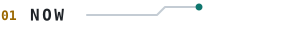
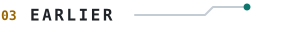

<picture><source media="(prefers-color-scheme: dark)" srcset="assets/banner-dark.svg"></picture>

 

<h3><picture><source media="(prefers-color-scheme: dark)" srcset="assets/h-now-dark.svg"></picture></h3>

<table>
  <tr>
    <td width="50%" valign="top">
       
      <h4><a href="https://github.com/YeomSoonWon/budgettracker-aws">budgettracker-aws</a></h4>
      Sync backend for a local-first macOS finance app, with all infrastructure as code. Dummy data only.
        
      <code>AWS CDK (Python)</code> <code>API Gateway</code> <code>Lambda</code> <code>DynamoDB</code> <code>Cognito</code> <code>KMS</code>
    </td>
    <td width="50%" valign="top">
       
      <h4><a href="https://github.com/YeomSoonWon/security-portfolio">security-portfolio</a></h4>
      Firmware static analysis write-ups on intentionally vulnerable targets, starting with OWASP IoTGoat.
        
      <code>binwalk</code> <code>squashfs-tools</code> <code>QEMU</code> <code>Ghidra</code>
    </td>
  </tr>
  <tr>
    <td colspan="2" valign="top">
       
      <h4>MyAssistant private</h4>
      macOS menu bar assistant that shows what to do now and manages schedules.
        
      <code>Swift</code>
    </td>
  </tr>
</table>

<h3><picture><source media="(prefers-color-scheme: dark)" srcset="assets/h-toolbox-dark.svg"></picture></h3>

<table>
  <tr><th align="left">Cloud</th><td><code>AWS CDK (Python)</code> <code>API Gateway</code> <code>Lambda</code> <code>DynamoDB</code> <code>Cognito</code> <code>KMS</code></td></tr>
  <tr><th align="left">Embedded</th><td><code>C/C++</code> <code>Qt</code> <code>AAOS</code></td></tr>
  <tr><th align="left">Security</th><td><code>binwalk</code> <code>QEMU</code> <code>Ghidra</code></td></tr>
  <tr><th align="left">Apps</th><td><code>Swift</code> <code>SwiftUI</code></td></tr>
</table>

<h3><picture><source media="(prefers-color-scheme: dark)" srcset="assets/h-earlier-dark.svg"></picture></h3>

<table>
  <tr><td><code>2023</code></td><td><a href="https://github.com/YeomSoonWon/YourButler">YourButler</a></td><td>SSAFY team project</td></tr>
  <tr><td><code>2022</code></td><td><a href="https://github.com/YeomSoonWon/ghost_nft_project">Ghost Cops NFT</a></td><td>Solidity</td></tr>
</table>

<h3><picture><source media="(prefers-color-scheme: dark)" srcset="assets/h-education-dark.svg"></picture></h3>

<table>
  <tr><td><code>2023</code></td><td>Samsung Software Academy For Youth (SSAFY) 9th</td><td>2023.01 – 2023.12</td></tr>
  <tr><td><code>2017 – 2023</code></td><td>Hanyang University</td><td>Applied Mathematics, Software</td></tr>
</table>
